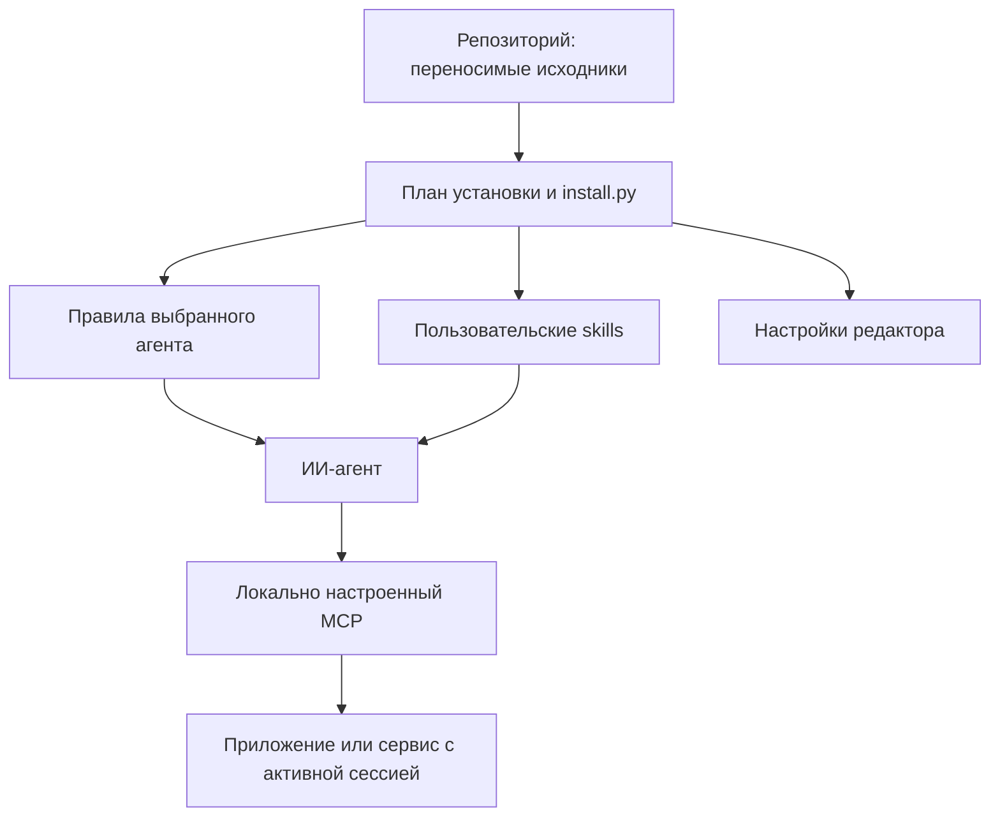

# Как всё связано

Я, ИИ-агент, использую этот набор так: постоянные правила помогают мне соблюдать
ваши предпочтения, skill объясняет отдельную процедуру, а инструмент выполняет
операцию. Настройка подключения сама по себе не даёт ни доступа к аккаунту,
ни открытого файла в другом приложении.

| Элемент | Что я с ним делаю | От чего зависит |
| --- | --- | --- |
| `codex/AGENTS.md` | Читаю постоянные предпочтения; для документов открываю нужные модули | Установка рядом с `document-rules/` |
| `codex/document-rules/` | Соблюдаю сохранность, оформление, проверку и источники документов | Задача пользователя; инструменты выбираются отдельно |
| `claude/CLAUDE.md` | Соблюдаю предпочтения авторства и области коммитов | Настроенная пользователем Git identity |
| `skills/figma-build` | Строю дизайн в Figma | Figwright MCP, plugin и открытая подключённая сессия |
| `skills/figma-codegen` | Получаю дизайн и реализую его в коде проекта | То же; дополнительно исходники и стек проекта |
| `skills/repomix-codebase-parsing` | Собираю контекст большого репозитория | Repomix; безопасно выбранный набор файлов |
| Настройки редактора | Задаю поведение сохранения и форматирования | Соответствующие расширения и среда проекта |
| `docs/plugins.json` | Помогаю выбрать необязательные функции | Каталог плагинов и возможности конкретного приложения |
| Кэш приложения | Не переношу; приложение пересоздаёт его само | Устройство, версия, аккаунт и runtime |

## Почему правила и skills разделены именно так

Правило выражает постоянное требование: сохранять документ, не придумывать
источники, не менять авторство Git. Оно не должно зависеть от того, догадался
ли агент выбрать skill. Поэтому модули документов остаются правилами с явным
маршрутом чтения из AGENTS.md.

Skill описывает процедуру с отдельным условием запуска: построить дизайн,
реализовать Figma-макет, упаковать репозиторий. Поэтому Figma-инструкции вынесены
из глобального CLAUDE.md в два соответствующих skills. Repomix также остаётся
skill; он не принуждает упаковывать репозиторий при каждом поиске символа.

Встроенные Cursor-skills, системные Codex-skills и skills плагинов поставляет
само приложение. Они удалены из набора вместе с кэшем, а не превращены в личные
правила. Сохраняются пользовательские workflows и нужные им references.

## Что остаётся на устройстве

Агент обнаруживает каталоги и доступные программы в текущей среде. Эти значения
могут отличаться между двумя установками одной ОС. Я не записываю обнаруженные
пути обратно в переносимые исходники. Доверие проектам, аккаунты, разрешения
команд, версия модели, интерпретатор и рабочие подключения остаются локальными.

Одинаковый набор файлов применим к Windows, macOS и Linux. Доступность каждого
приложения, плагина и команды определяется их текущей поддержкой платформ:
переносимость конфигурации не заменяет проверку совместимости.
